
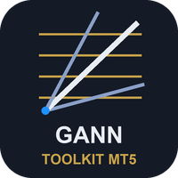

# Gann Toolkit (MetaTrader 5 and MetaTrader 4)

An indicator that draws **W.D. Gann's price and time tools from the swings it confirms**: Square of 9 levels, Gann fan angles and the Gann box, together with the HiLo Activator and swing line, a multi-symbol trend table and alerts.

> **This is a showcase repository: documentation and images only. There is no source code here.** The product is sold on
> the MQL5 Market. The free indicator it relates to has public source:
> [allanninal/gann-hilo-swing](https://github.com/allanninal/gann-hilo-swing).

**Website:** [allanninal.dev/mql5 (indicators)](https://www.allanninal.dev/mql5/#indicators) · [MT4 editions](https://www.allanninal.dev/mql5/#mt4) · [allanninal.dev](https://www.allanninal.dev)
· **Contact:** message me on [LinkedIn](https://www.linkedin.com/in/allanninal/).

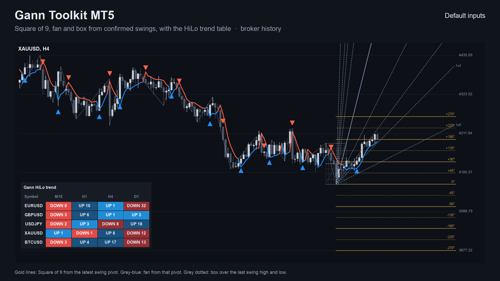

## Get it on the MQL5 Market

| Product | Platform | Price | Link |
|---|---|---|---|
| **Gann Toolkit** | MT5 | paid | <https://www.mql5.com/en/market/product/201807> |
| **Gann Toolkit MT4** | MT4 | paid | <https://www.mql5.com/en/market/product/202424> |
| Gann HiLo Swing (source on GitHub) | MT5 | free | <https://www.mql5.com/en/market/product/201806> |
| Gann HiLo Swing MT4 (source on GitHub) | MT4 | free | <https://www.mql5.com/en/market/product/202367> |

The paid product is standalone: you do not need to install the free indicator to use it. Details, current price and the
Strategy Tester demo are on the Market pages.

## What it does

- **Square of 9 levels** above and below the latest swing pivot (or a price you enter), labelled in degrees, with an adjustable step (default 45 degrees) and number of levels.
- **Gann fan** angles from the latest swing pivot (1x8 up to 8x1); the 1x1 angle follows the last swing's own speed or a value you set.
- **Gann box** over the last swing high and low, divided in eighths and thirds in price and in time.
- The **HiLo Activator line, swing line and new-trend arrows** of the free indicator.
- A **table of symbols and timeframes** showing UP or DOWN and the closed bars since the last new trend; click a cell to open that chart.
- **Alerts** for a new trend on the chart, a bar closing across a Square of 9 level, and new trends in the table (sent as one message): pop-up (on by default), sound, push notification, e-mail. Nothing is sent while history loads or in the Strategy Tester.
- The levels, angles and box use confirmed swing pivots on closed bars and change only when a new swing is confirmed. They are **reference prices from Gann's method, not signals**.
- Level spacing is stated in the listing (for example a 45-degree step is close to 1% of the price on any symbol, because the price is scaled to four digits first).

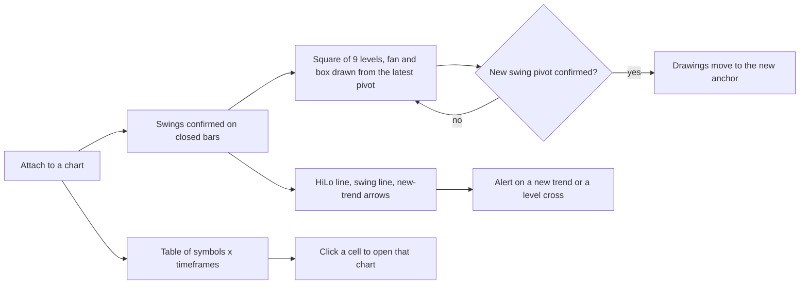

### What the chart holds

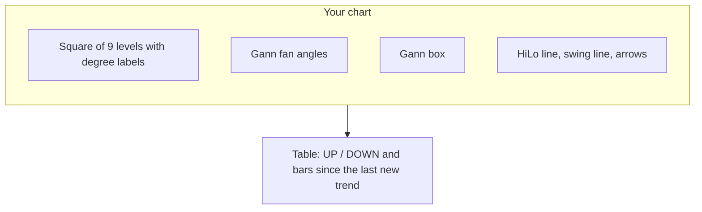

### Table cell states

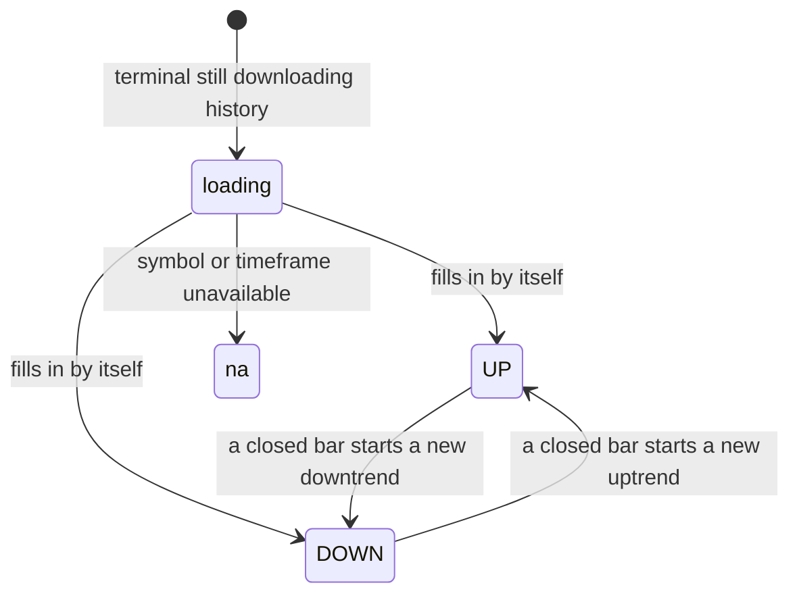

| | |
|---|---|
|  | 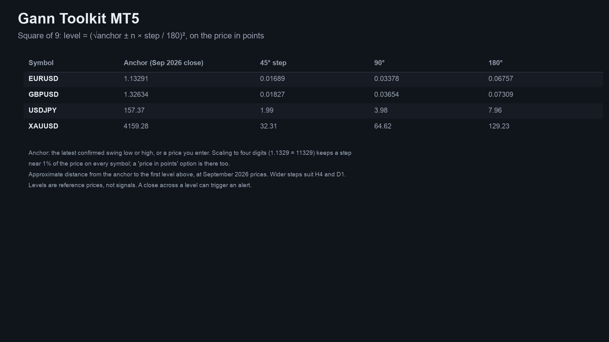 |
| 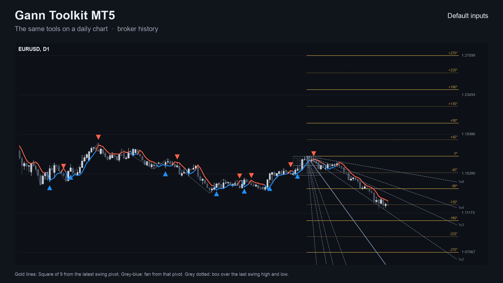 | 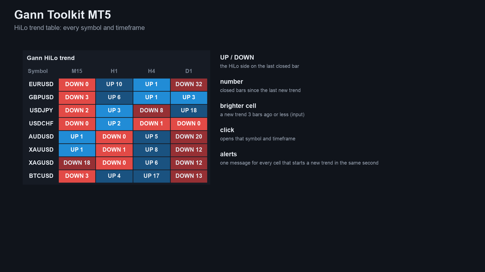 |
| 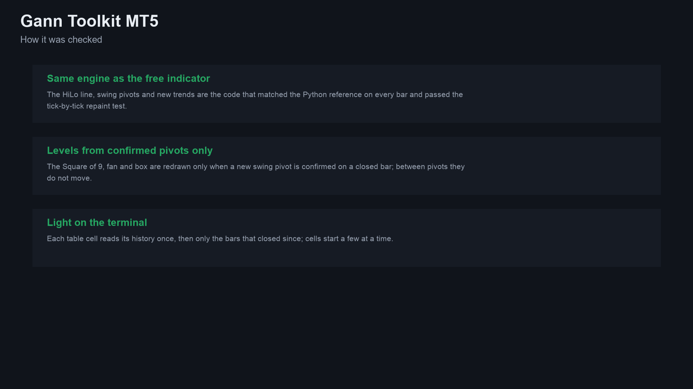 | 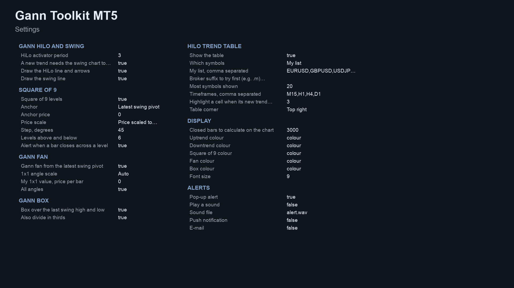 |

MT4 edition screenshots: [toolkit on XAUUSD H4](images/mt4/01-toolkit-xauusd-h4.png), [Square of 9 levels](images/mt4/02-square-of-9.png), [EURUSD D1](images/mt4/03-eurusd-d1.png). Some screenshots are illustrations built from broker history, not terminal captures.

## Who it is for

Traders who use Gann's levels, angles and boxes and want them drawn the same way on every chart instead of placed by hand. If you only need the HiLo trend line, the free [Gann HiLo Swing](https://www.mql5.com/en/market/product/201806) is enough.

## Why it was built

- Our October 2026 market research found Gann is the best-priced classic method on the MQL5 Market, and that buyers mostly want Gann **levels and geometry** (Square of 9, angles, boxes) rather than HiLo arrows. The free indicator already covers the trend line.
- Gann's tools are esoteric and carry no tested edge: an expert advisor trading the HiLo and swing rules did not pass out-of-sample testing. So this is sold as a **chart tool that draws reference prices**, never as a signal, and the listing says so.
- Design rule carried over from the free indicator: trust. Everything uses closed bars and confirmed swings, so nothing is redrawn except when a new swing is confirmed.

## How it was checked (results)

The HiLo line, swings and new trends are the engine of the free indicator, which matched an independent Python calculation on every bar and passed an every-tick repaint test. The toolkit was checked on its own too.

| Check | MT5 edition | MT4 edition |
|---|---|---|
| Toolkit on its defaults vs the Python calculation | 12 of 12 files identical (4 symbols x M15, H1, H4): line, side, trend, arrows, pivots | 25 of 25 files identical (EURUSD, GBPJPY, XAUUSD, BTCUSD x M15, H1, H4, two settings) |
| Repaint probe | XAUUSD H1, every tick, 91,052,717 ticks, 506 signals: 0 changed, 0 on the forming bar | EURUSD H1, every tick, 8,417,316 ticks, 573 arrows: 0 changed |
| Trend table | - | 1,091,874 bar records compared (108 files), 0 differences; each of 63,887 table alerts came on the bar that started the trend |

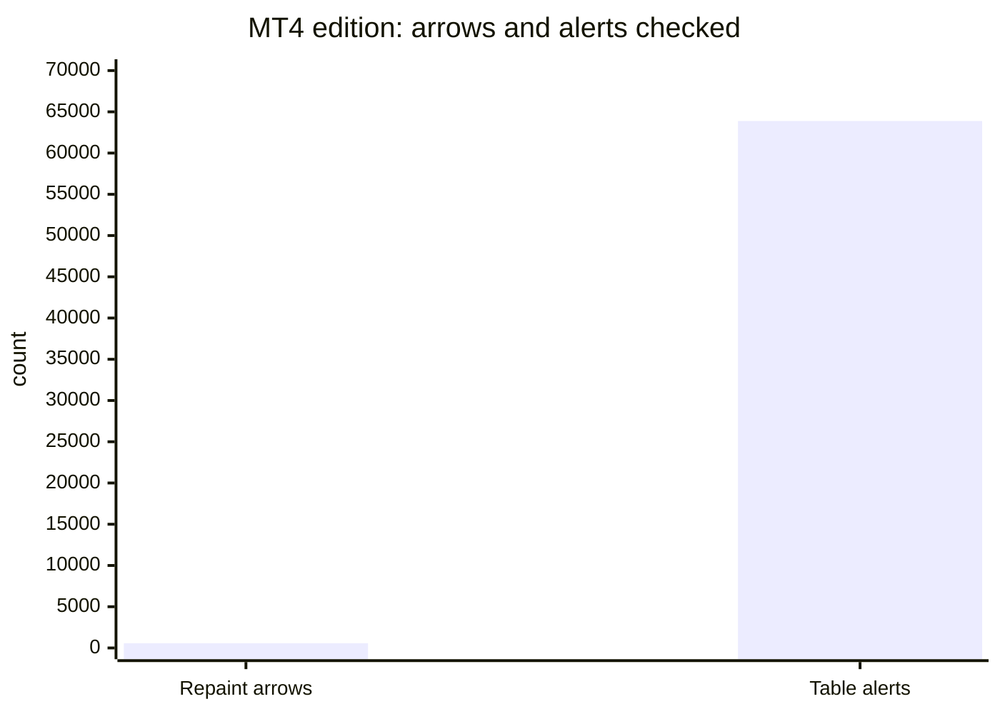

These are code checks, not trading results. Levels, angles and the box are redrawn only when a new swing pivot is confirmed on a closed bar.

## Honest limits

- Gann's tools are a way of reading the chart. The levels are reference prices: price may react near them or pass through, and the indicator does not predict which. No profit or accuracy claim is made.
- When a new swing pivot is confirmed the anchor changes and the drawings move; choose a fixed price to keep one anchor.
- Gann's methods have several modern interpretations; the product uses the one stated in its listing.
- It is an indicator: it places no orders and manages no risk.
- It needs the terminal running to alert, and push needs your MetaQuotes ID set up in the terminal.
- The source is not published; this repository documents what the product does and the results of its checks.

## Free vs paid

| | Gann HiLo Swing (free) | Gann Toolkit (paid) |
|---|---|---|
| Scope | HiLo line and swing line on one chart | the same, plus price and time tools drawn from the swings, and a multi-symbol table |
| Output | line, swing line, new-trend arrows | levels, angles, box, table, arrows |
| Alerts | pop-up, sound, push, e-mail (new trend) | pop-up, sound, push, e-mail (trend, level cross, table) |
| MT5 | [201806](https://www.mql5.com/en/market/product/201806) | [201807](https://www.mql5.com/en/market/product/201807) |
| MT4 | [202367](https://www.mql5.com/en/market/product/202367) | [202424](https://www.mql5.com/en/market/product/202424) |
| Source | [public on GitHub](https://github.com/allanninal/gann-hilo-swing) | not published |

---

**Website:** [allanninal.dev/mql5](https://www.allanninal.dev/mql5/#indicators) · [MT4](https://www.allanninal.dev/mql5/#mt4) · [allanninal.dev](https://www.allanninal.dev)
· Questions: message me on [LinkedIn](https://www.linkedin.com/in/allanninal/). All rights reserved, see [LICENSE](LICENSE).
Copyright 2026 Allan Niñal (https://www.allanninal.dev/mql5). All rights reserved.

This repository contains documentation and images only; it contains no source code. The text and images may not be
copied, redistributed or used commercially without written permission. The Gann Toolkit products themselves are
distributed only through the MQL5 Market under the Market's own terms.
